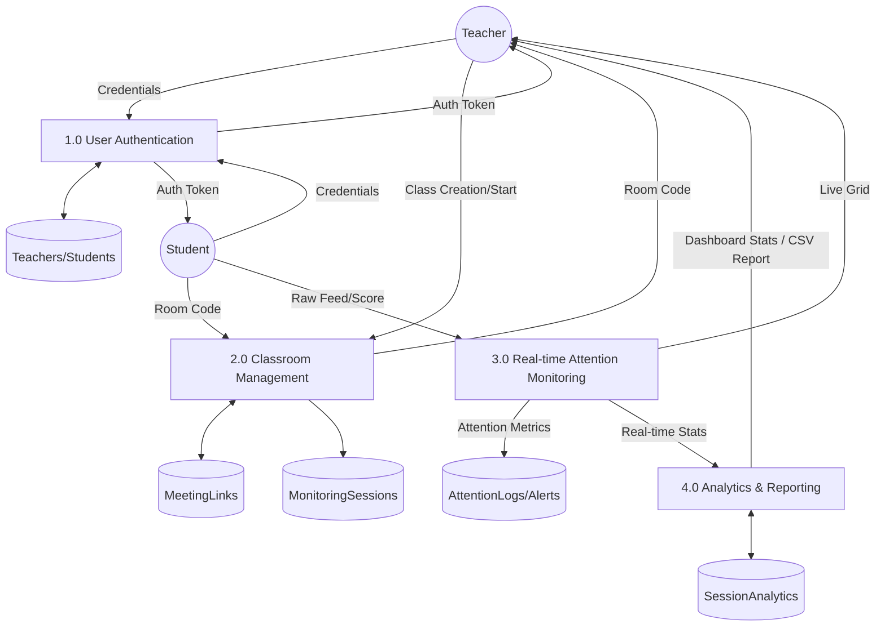
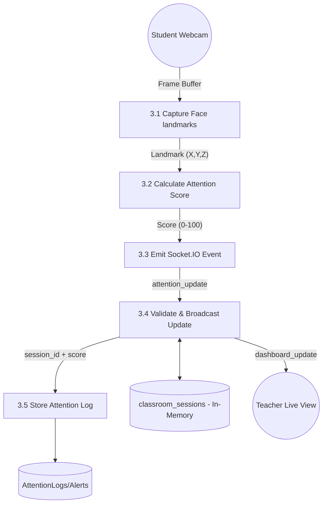

# EduSense AI Classroom - Data Flow Diagrams (DFD)

This document outlines the data flow within the EduSense AI Classroom system, moving from high-level context to detailed process-specific flows.

## Level 0: Context Diagram
The Context Diagram defines the system boundary and the interactions between the system and external entities.

```mermaid
graph LR
    subgraph System ["EduSense AI Classroom"]
    end

    Teacher ((Teacher))
    Student ((Student))

    %% Teacher Flows
    Teacher -- "Login Credentials / Class Name" --> System
    System -- "Auth Token / Room Code" --> Teacher
    System -- "Live Dashboard / Analytics Reports" --> Teacher

    %% Student Flows
    Student -- "Login Credentials / Room Code" --> System
    Student -- "Real-time Attention Data" --> System
    System -- "Auth Token / Media Stream" --> Student
```

---

## Level 1: System-Wide Data Flow
Level 1 breaks the system down into its primary functional processes and identifies the core data stores.



---

## Level 2: Attention Monitoring (Process 3.0)
Level 2 provides a detailed breakdown of the real-time monitoring pipeline, specifically the data movement from the student's facial capture to the backend storage and teacher's display.



## DFD Element Definitions

### External Entities
- **Teacher**: Creates classes, manages sessions, and views performance data.
- **Student**: Joins classes and provides real-time attention data via their device camera.

### Processes
- **User Authentication**: Validates user credentials and provides JWT for secure API access.
- **Classroom Management**: Handles the generation of room codes and the instantiation of monitoring sessions.
- **Real-time Attention Monitoring**: The core logic that processes AI-detected facial landmarks into actionable attention scores and broadcasts them via WebSockets.
- **Analytics & Reporting**: Aggregates session data and generates visualizations or downloadable reports.

### Data Stores
- **Teachers/Students**: User profiles and hashed credentials.
- **MeetingLinks**: Metadata for created class rooms.
- **MonitoringSessions**: Records of student presence and performance per class.
- **AttentionLogs/Alerts**: High-resolution time-series data of student metrics.
- **SessionAnalytics**: Grouped summaries used for historical reporting.
