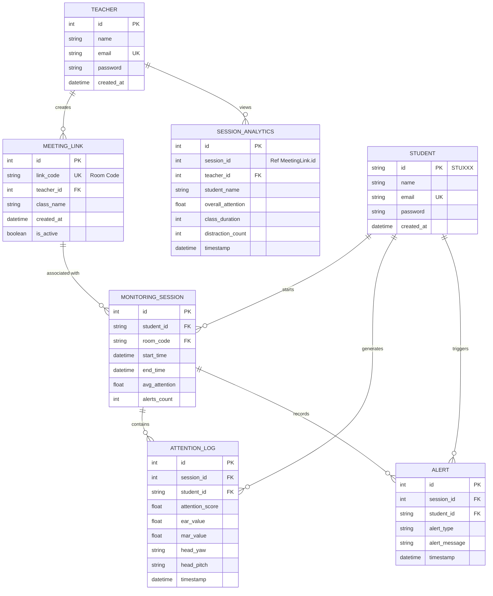

# LearnLens AI Classroom - Entity Relationship Diagram

This document provides a clear representation of the database schema for the LearnLens AI Classroom project.

## ER Diagram (Mermaid Format)

## Entities Description

### 1. Teacher
Stores information about educators who can create classes and view analytics.
- **id**: Unique identifier (Primary Key).
- **email**: Unique email for login.
- **password**: Hashed password.

### 2. Student
Stores information about students enrolled in the system.
- **id**: Custom ID string (e.g., STU001) (Primary Key).
- **email**: Unique email for login.

### 3. MeetingLink (Class)
Represents a class session created by a teacher.
- **link_code**: The code shared with students to join.
- **teacher_id**: Relationship to the teacher who created it.

### 4. MonitoringSession (Attendance)
Created when a student joins a class. It tracks their individual participation in a specific session.
- **room_code**: Links to the meeting link.
- **student_id**: Links to the student.

### 5. AttentionData (AttentionLog)
High-frequency logs recording attention metrics during a session.
- **attention_score**: Calculated percentage of attention.
- **ear_value/mar_value**: Eye and Mouth Aspect Ratios from MediaPipe.

### 6. Alert
Detailed logs of behavioral anomalies detected during a session.
- **alert_type**: Categorizes the alert (e.g., "Behavior" for status changes).
- **alert_message**: Describes the specific cause (e.g., "Status: Looking Away" or "Status: Distracted").
- **session_id/student_id**: Links the alert to the specific student and class session.

### 7. SessionAnalytics
Aggregated data saved after a class ends, used for generating reports and dashboard visualizations.
